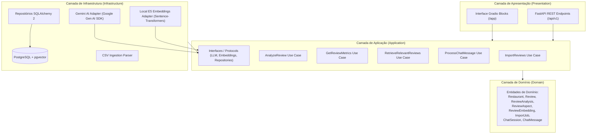

# MesaIQ — Restaurant Feedback Intelligence

> Plataforma inteligente de análise de feedbacks para restaurantes com processamento de linguagem natural, métricas determinísticas e assistente conversacional fundamentado em evidências.

---

## 1. Visão Geral

O **MesaIQ** é uma aplicação de inteligência artificial voltada para proprietários e gestores de restaurantes. O objetivo central é transformar volumes expressivos de avaliações textuais (feedbacks de clientes) em inteligência acionável para a operação e gestão do negócio.

Em vez de apenas exibir notas agregadas ou forçar a leitura manual de centenas de comentários, o MesaIQ combina:
- **Modelos de Linguagem (LLMs)** com saídas estruturadas (*Structured Outputs*) para extração confiável de sentimentos e aspectos específicos (ex.: comida, atendimento, entrega).
- **Métricas Determinísticas em SQL** no PostgreSQL para garantir que contagens, médias e distribuições temporais sejam matematicamente exatas, sem alucinações.
- **Embeddings Locais e Busca Semântica (RAG)** via `pgvector` para recuperação de contextos e feedbacks relevantes.
- **Assistente Conversacional com Tool Calling** para responder a dúvidas operacionais citando diretamente as avaliações que sustentam suas respostas.

---

## 2. O Problema

Restaurantes recebem avaliações continuamente por meio de múltiplos canais. No entanto, gestores enfrentam dois desafios críticos:
1. **Sobrecarga de Informação**: Ler manualmente centenas de feedbacks consome tempo excessivo e inviabiliza diagnósticos rápidos.
2. **Superficialidade das Notas**: Saber que a nota média caiu de 4.5 para 3.8 não explica *o motivo* (se o atraso foi no entregador parceiro, se a embalagem vazou ou se o prato esfriou).

---

## 3. Funcionalidades da Versão Atual (MVP)

- **Ingestão de Avaliações por CSV**: Upload, validação de esquema, rastreabilidade de origem (`source_system`), deduplicação por `(restaurant_id, source_system, external_id)` e persistência no PostgreSQL com registro prévio de auditoria por lote (*ImportJob*).
- **Análise Semântica de Feedbacks com LLM**: Classificação de sentimento geral, geração de resumo conciso e identificação granular de aspectos (`food_quality`, `delivery`, `packaging`, `customer_service`, `price_value`, `other`) com suas respectivas evidências textuais.
- **Histórico e Reprocessamento de Análises**: Suporte a múltiplas análises por avaliação vinculadas à configuração ativa `(review_id, provider_name, model_name, prompt_version)`, reserva individual atômica com esgrima via `attempt_id`, recuperação de processos abandonados via timeout configurável e registro de estados (`PENDING`, `PROCESSING`, `COMPLETED`, `FAILED`).
- **Analytics Determinístico**: Dashboard analítico alimentado exclusivamente por consultas SQL agregadas (média de notas, volume temporal, distribuição de sentimentos e tópicos críticos).
- **Busca Semântica & RAG**: Geração local de embeddings com o modelo ativo `intfloat/multilingual-e5-small` (com rastreamento de `model_revision`) e indexação vetorial via `pgvector`.
- **Assistente com Tool Calling Seguro e Citações Fundamentadas**: Chatbot interativo que consulta dados via catálogo restrito de ferramentas tipadas, utilizando `review_id` canônico interno, proibindo SQL arbitrário, com validação referencial no servidor e exibição de `source_system`, `external_id` e trechos originais do banco no frontend.
- **Interface Integrada Gradio Blocks**: Painel amigável montado diretamente no backend FastAPI sob a rota `/app`.

---

## 4. Stack Tecnológica

| Componente | Tecnologia | Papel no Sistema |
|---|---|---|
| **Linguagem** | Python 3.12 | Base de desenvolvimento moderna e fortemente tipada |
| **Gerenciador de Pacotes** | uv | Resolução ultrarrápida de dependências e ambientes virtuais |
| **Backend API** | FastAPI | Roteamento HTTP de alta performance e montagem do Gradio |
| **Validação e Configurações** | Pydantic v2 + pydantic-settings | Esquemas estruturados, DTOs e validação estrita de variáveis de ambiente |
| **ORM & Migrations** | SQLAlchemy 2 + Alembic | Modelagem relacional e versionamento estrito de esquema |
| **Banco Relacional & Vetorial** | PostgreSQL + pgvector | Armazenamento de dados relacionais e vetores (384 dimensões) |
| **LLM Provider** | Google Gemini API (Gen AI SDK) | Análise de texto, extração estruturada e tool calling |
| **Modelo de Embeddings** | `intfloat/multilingual-e5-small` | Embeddings densos gerados localmente sem custos de API |
| **Frontend / UI** | Gradio Blocks | Interface web interativa (Chatbot + Analytics + Ingestão) montada em `/app` |
| **Testes & Qualidade** | Pytest + HTTPX + Ruff + mypy | Testes unitários/integração, linting, formatação e verificação estática de tipos |
| **Containerização** | Docker + Docker Compose | Padronização de ambiente de banco e execução |
| **CI / Integração Contínua** | GitHub Actions | Pipeline automatizado de linting, checagem de tipos e testes |

---

## 5. Arquitetura em Alto Nível

O MesaIQ adota o padrão de **Monólito Modular** com princípios de Clean Architecture / Portas e Adaptadores:

---

## 6. Status do Projeto & Roadmap Resumido

O projeto é executado de forma incremental e orientada a entregas bem definidas:

- [ ] **Entrega 0: Product Definition & Architecture** (Em revisão)
- [ ] **Entrega 1: Backend Foundation** (Ambiente, dependências com `uv`, FastAPI base, SQLAlchemy 2, migrations Alembic, `pydantic-settings`, `mypy` e `ruff`)
- [ ] **Entrega 2: Review Management & Ingestion** (Parsing de CSV com `source_system`, validação e persistência de avaliações com auditoria de `ImportJob`)
- [ ] **Entrega 3: AI Analysis** (Integração Gemini com Structured Outputs, histórico por configuração ativa `(provider, model, prompt)`, ciclo de reserva com locks efêmeros e recuperação de análises abandonadas)
- [ ] **Entrega 4: Embeddings & RAG** (Integração local de `multilingual-e5-small`, execução em thread pool, rastreabilidade de `model_revision` e busca vetorial com pgvector)
- [ ] **Entrega 5: AI Chatbot & Tool Calling** (Orquestrador conversacional, ferramentas fortemente tipadas com `review_id` canônico, validação referencial no servidor e exibição de fontes autorizadas)
- [ ] **Entrega 6: Gradio Interface & Analytics** (Dashboard e chat integrados sob `/app`)
- [ ] **Entrega 7: Evaluation, Quality & Deployment** (Suíte de avaliação de IA, testes ponta a ponta, Docker Compose e GitHub Actions CI)

Para o detalhamento de cada fase, consulte o [Roadmap Completo](docs/ROADMAP.md).

---

## 7. Documentação do Projeto

Aprofunde-se nos detalhes de engenharia e produto nos documentos dedicados:

- **[Documento de Requisitos do Produto (PRD)](docs/PRD.md)**: Visão de produto, requisitos funcionais (RF-01 a RF-07), requisitos não funcionais e personas.
- **[Arquitetura do Sistema](docs/ARCHITECTURE.md)**: Diagramas C4, esquemas de dados, fluxos de RAG/Tool Calling e contratos entre camadas.
- **[Instruções para Agentes de Desenvolvimento](AGENTS.md)**: Princípios técnicos e padrões obrigatórios para o desenvolvedor e agentes de IA.
- **[Architecture Decision Records (ADRs)](docs/adr/)**:
  - [ADR-0001: Arquitetura Monólito Modular](docs/adr/ADR-0001-modular-monolith.md)
  - [ADR-0002: Gradio Blocks como Camada de Apresentação](docs/adr/ADR-0002-gradio-presentation.md)
  - [ADR-0003: PostgreSQL com pgvector para Dados Relacionais e Vetoriais](docs/adr/ADR-0003-postgresql-pgvector.md)
  - [ADR-0004: Integração de Provedores de IA Desacoplada](docs/adr/ADR-0004-ai-provider-abstraction.md)
