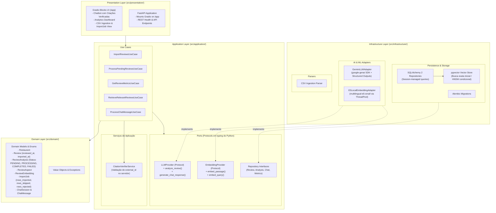
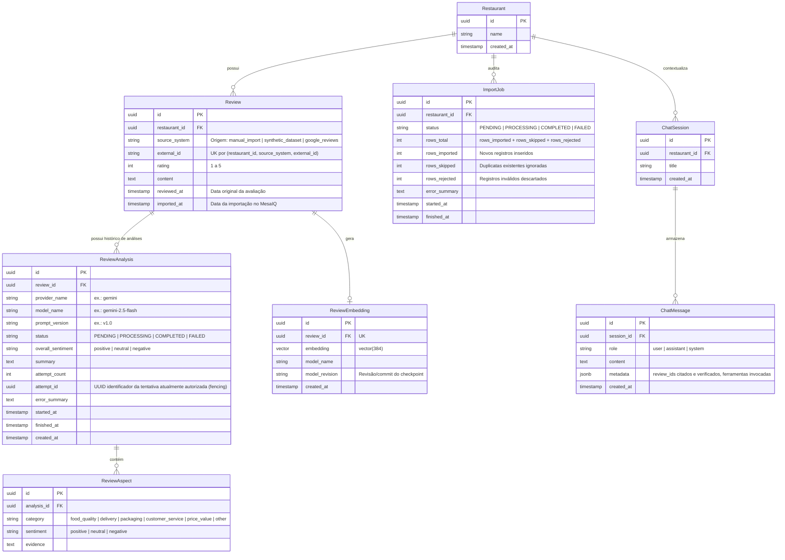
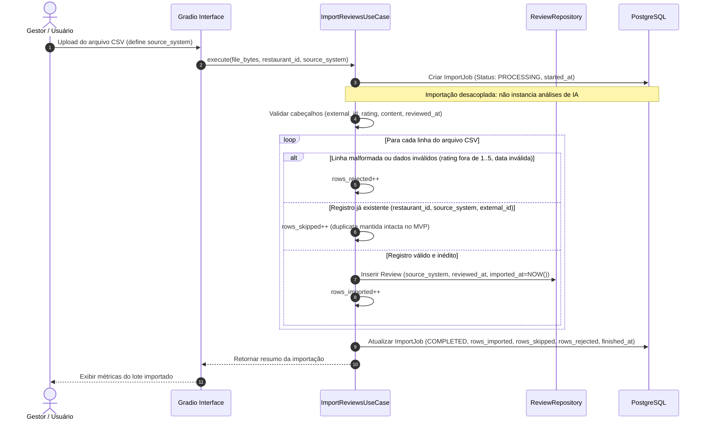
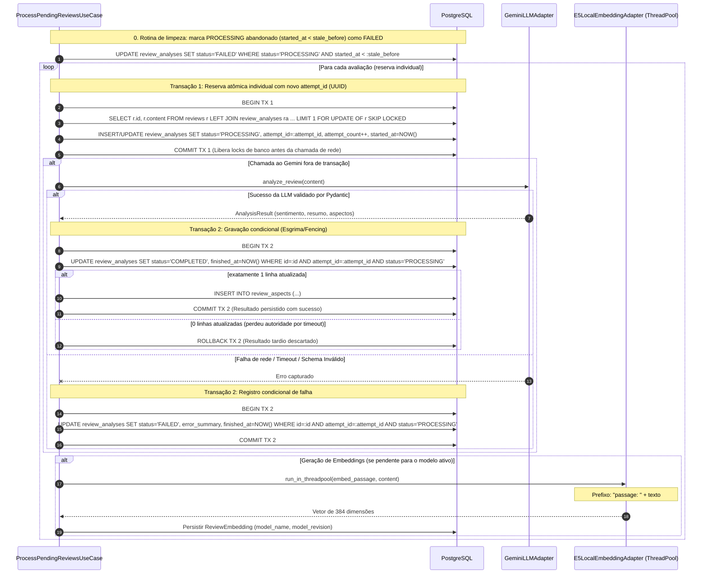
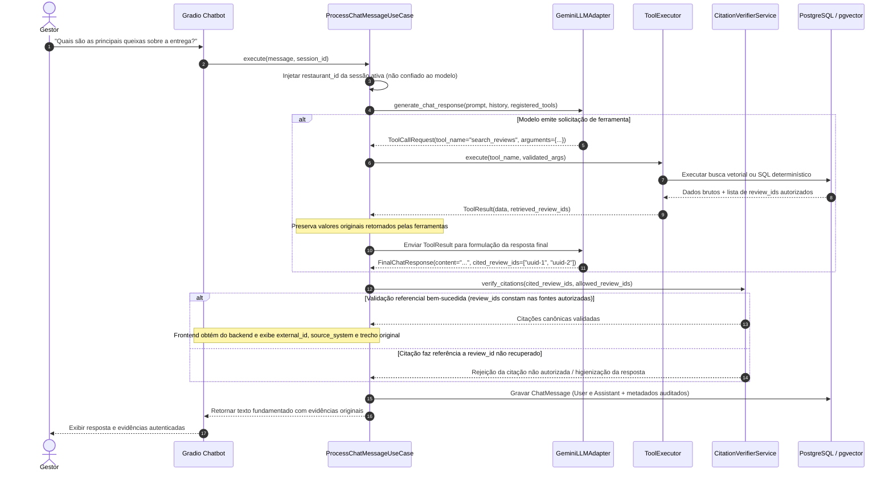

# Arquitetura do Sistema — MesaIQ

**Versão:** 1.1  
**Status:** Em revisão humana  
**Responsável pelo Projeto:** Desenvolvedor do Projeto (Estudante de Ciência da Computação)  

---

## 1. Visão Arquitetural

O **MesaIQ** adota o padrão de **Monólito Modular** guiado pelos princípios da Clean Architecture e Portas e Adaptadores (Hexagonal). Esta escolha assegura simplicidade operacional e viabilidade de execução para um desenvolvedor individual, mantendo baixo acoplamento interno e facilidade de substituição de componentes externos (banco, provedores de IA, interface web).

### 1.1 Diagrama de Componentes e Camadas



---

## 2. Modelagem de Dados e Relacionamentos

### 2.1 Diagrama Entidade-Relacionamento (ERD)



### 2.2 Restrições de Integridade e Estratégia de Índices

1. **Identificação e Deduplicação de Avaliações por Origem**:
   ```sql
   CREATE UNIQUE INDEX uq_restaurant_source_external ON reviews (restaurant_id, source_system, external_id);
   ```
2. **Unicidade de Análise por Configuração de IA**:
   ```sql
   CREATE UNIQUE INDEX uq_review_ai_config ON review_analyses (review_id, provider_name, model_name, prompt_version);
   ```
3. **Busca Eficiente e Ciclo Transacional de Reserva Individual**:
   Em PostgreSQL, predicados de índices parciais não aceitam subconsultas (`WHERE id NOT IN (SELECT ...)`). Portanto, a descoberta e reserva de avaliações elegíveis para a configuração ativa é realizada através de um ciclo transacional estrito com reserva individual:
   ```sql
   -- Índice B-tree na FK de review_analyses para acelerar junções e checagem de existência:
   CREATE INDEX idx_review_analyses_review_id ON review_analyses (review_id);

   -- Índice composto para acelerar filtro por configuração ativa e status:
   CREATE INDEX idx_review_analyses_lookup ON review_analyses (provider_name, model_name, prompt_version, status);

   -- Consulta no ProcessPendingReviewsUseCase com FOR UPDATE OF r SKIP LOCKED:
   -- 1. Avaliações que nunca foram analisadas para a configuração ativa (ra.id IS NULL)
   -- 2. Análises em status PENDING
   -- 3. Análises em status FAILED com attempt_count < :max_attempts
   SELECT r.id, r.restaurant_id, r.content, ra.id AS analysis_id, COALESCE(ra.attempt_count, 0) AS current_attempts
   FROM reviews r
   LEFT JOIN review_analyses ra 
       ON r.id = ra.review_id 
       AND ra.provider_name = :active_provider 
       AND ra.model_name = :active_model 
       AND ra.prompt_version = :active_prompt_version
   WHERE r.restaurant_id = :restaurant_id 
     AND (
         ra.id IS NULL 
         OR ra.status = 'PENDING'
         OR (ra.status = 'FAILED' AND ra.attempt_count < :max_attempts)
     )
   ORDER BY r.reviewed_at ASC
   LIMIT 1
   FOR UPDATE OF r SKIP LOCKED;
   ```

   **Ciclo Transacional de Reserva e Execução com Esgrima de Concorrência (Fencing via attempt_id)**:
   1. *Abrir Transação 1*: Executa o `SELECT ... FOR UPDATE OF r SKIP LOCKED LIMIT 1`.
   2. *Reservar com Novo attempt_id*: A aplicação gera um novo identificador único de tentativa (`attempt_id = uuid4()`). Insere ou atualiza o registro em `review_analyses` com `status = 'PROCESSING'`, `attempt_id = :attempt_id`, `started_at = NOW()` e `attempt_count = attempt_count + 1`.
   3. *Commit da Transação 1*: Finaliza a transação imediatamente, liberando todos os locks de banco de dados antes da chamada de rede.
   4. *Execução Externa*: Aciona a API externa do Google Gemini via rede (fora de transação e sem reter conexões do pool).
   5. *Abrir Transação 2*: Após o retorno da API ou captura de erro, abre uma nova transação rápida.
   6. *Persistir com UPDATE Condicional*: Executa a atualização garantindo que a tentativa ainda detém a autoridade da reserva:
      ```sql
      UPDATE review_analyses
      SET status = 'COMPLETED',
          overall_sentiment = :overall_sentiment,
          summary = :summary,
          finished_at = NOW()
      WHERE id = :analysis_id
        AND attempt_id = :attempt_id
        AND status = 'PROCESSING';
      ```
      - Se exatamente **1 registro for atualizado**: a autoridade foi confirmada; prossegue com a persistência dos aspectos em `review_aspects`.
      - Se **0 registros forem atualizados**: a tentativa perdeu a reserva (por exemplo, sofreu recuperação por timeout e outra tentativa assumiu a análise com novo `attempt_id`). O resultado tardio é sumariamente descartado.
      - Caso a chamada externa tenha falhado, o mesmo UPDATE condicional é executado para marcar `status = 'FAILED'`, evitando que uma falha tardia sobrescreva uma tentativa já concluída ou reatribuída.
   7. *Commit da Transação 2*: Finaliza a transação.

4. **Recuperação de Análises Abandonadas (`PROCESSING`) com Timeout Parametrizado**:
   Caso o processo da aplicação falhe abruptamente (ex.: crash de container ou interrupção de rede não tratada), o registro poderá permanecer em `PROCESSING`.
   - **Timeout Parametrizado em Configurações**: Utiliza o parâmetro `ANALYSIS_PROCESSING_TIMEOUT_SECONDS` (centralizado em `pydantic-settings`), configurado com valor estritamente superior ao timeout máximo da requisição ao LLM com margem de segurança.
   - **Cálculo da Data de Corte (`stale_before`)**: A aplicação calcula o timestamp limite em memória (`stale_before = datetime.now(timezone.utc) - timedelta(seconds=settings.ANALYSIS_PROCESSING_TIMEOUT_SECONDS)`) e o envia como parâmetro tipado para a consulta:
     ```sql
     UPDATE review_analyses
     SET status = 'FAILED',
         error_summary = 'Timeout de processamento excedido (processo abandonado)',
         finished_at = NOW()
     WHERE status = 'PROCESSING'
       AND started_at < :stale_before;
     ```
   - Registros recuperados que ainda possuam `attempt_count < max_attempts` tornam-se automaticamente elegíveis para nova tentativa nas próximas rodadas. Quando uma nova tentativa for reservada, um novo `attempt_id` será gerado, invalidando qualquer resposta atrasada da tentativa anterior.

5. **Definição da Análise Vigente**:
   A análise vigente de uma avaliação **não é determinada por ordenação temporal arbitrária de qualquer modelo** (`finished_at DESC`), mas sim pela correspondência exata com a **configuração ativa do sistema** (`provider_name`, `model_name`, `prompt_version`), definida de forma centralizada nas configurações da aplicação (`pydantic-settings`). Isso garante reprodutibilidade, estabilidade e viabiliza futuras avaliações comparativas entre modelos sem que um teste pontual substitua as métricas oficiais de produção:
   ```sql
   SELECT ra.*
   FROM review_analyses ra
   WHERE ra.review_id = :review_id 
     AND ra.provider_name = :active_provider
     AND ra.model_name = :active_model
     AND ra.prompt_version = :active_prompt_version
     AND ra.status = 'COMPLETED';
   ```

6. **Estratégia de Armazenamento Vetorial e Governança de Embeddings**:
   - Relação 1:0..1 no MVP (`Review` → `ReviewEmbedding`).
   - O MVP opera com **um único modelo ativo de embeddings** (`intfloat/multilingual-e5-small`, dimensão 384).
   - Metadados do modelo e revisão do checkpoint (`model_name`, `model_revision`) são obrigatoriamente registrados na entidade `ReviewEmbedding`.
   - **Regra de Troca de Modelo**: A aplicação **nunca compara vetores de modelos ou revisões heterogêneas**. Se o modelo ou a revisão forem alterados no futuro, os embeddings existentes deverão ser reprocessados/reconstruídos integralmente via migração controlada.
   - **Busca Exata Inicial**: Inicialmente, a recuperação semântica no `pgvector` é executada de forma exata (`ORDER BY embedding <=> :query_embedding LIMIT :k`), dispensando parâmetros complexos de aproximação no MVP. A adoção de índices aproximados (HNSW com `vector_cosine_ops`) dependerá de benchmark que comprove ganho real de latência sem perda de `Recall@5`.

---

## 3. Fluxos de Dados e Sequência

### 3.1 Fluxo de Ingestão de Avaliações por CSV e Auditoria de Job



### 3.2 Fluxo de Processamento de IA, Histórico e Reprocessamento de Falhas

O MVP **não utiliza** filas distribuídas ou corretores externos (RabbitMQ, Kafka, Celery ou Redis). O processamento de avaliações é desacoplado da ingestão e ocorre de maneira controlada pela camada de aplicação através do caso de uso `ProcessPendingReviewsUseCase`:



### 3.3 Fluxo Conversacional com Tool Calling e Verificação no Servidor



---

## 4. Responsabilidades por Camada Arquitetural

| Camada | Diretório | Responsabilidade | Regra de Dependência |
|---|---|---|---|
| **Domain** | `src/domain/` | Entidades puras, Dataclasses nativas, Enums, Value Objects e regras invariantes do negócio. | Depende exclusivamente da biblioteca padrão do Python (`dataclasses`, `enum`, `typing`, `datetime`, `uuid`). Não depende de Pydantic, SQLAlchemy, FastAPI, Gradio ou provedores de IA. |
| **Application** | `src/application/` | Casos de uso, DTOs e esquemas de validação Pydantic v2, contratos de interfaces (*Protocols* em `typing`) e serviços de aplicação (ex.: `CitationVerifierService`). | Não depende de frameworks web (FastAPI/Gradio) nem de adaptadores concretos de infraestrutura. |
| **Infrastructure** | `src/infrastructure/` | Adaptadores concretos: persistência SQLAlchemy 2, Alembic, cliente Gemini via `google-genai`, embeddings locais em thread pool e parser CSV. | Implementa as portas definidas na camada de aplicação e encapsula SDKs e bancos externos. |
| **Presentation** | `src/presentation/` | Componentes Gradio Blocks, rotas REST do FastAPI e formatação de saídas para o usuário. | Delega chamadas unicamente aos Casos de Uso da camada de aplicação. Não acessa o banco nem provedores diretamente. |

---

## 5. Estrutura de Diretórios Planejada

```text
mesaiq/
├── AGENTS.md                          # Instruções mandatórias para desenvolvimento
├── README.md                          # Apresentação do sistema e visão geral
├── pyproject.toml                     # Configuração de dependências via uv
├── .gitignore                         # Arquivos ignorados pelo controle de versão
├── docs/                              # Documentação de engenharia e produto
│   ├── PRD.md                         # Requisitos funcionais, não funcionais e personas
│   ├── ARCHITECTURE.md                # Desenho arquitetural, diagramas e contratos
│   ├── ROADMAP.md                     # Cronograma de entregas incrementais
│   └── adr/                           # Architecture Decision Records
│       ├── ADR-0001-modular-monolith.md
│       ├── ADR-0002-gradio-presentation.md
│       ├── ADR-0003-postgresql-pgvector.md
│       └── ADR-0004-ai-provider-abstraction.md
├── src/                               # Código-fonte da aplicação
│   ├── __init__.py
│   ├── domain/                        # Entidades e enums puros
│   │   ├── __init__.py
│   │   ├── entities.py                # Restaurant, Review, ReviewAnalysis, etc.
│   │   └── enums.py                   # Sentiment, AspectCategory, JobStatus, AnalysisStatus
│   ├── application/                   # Casos de uso e portas
│   │   ├── __init__.py
│   │   ├── ports/                     # Contratos abstratos (Protocols)
│   │   │   ├── llm_provider.py
│   │   │   ├── embedding_provider.py
│   │   │   └── repositories.py
│   │   ├── dtos/                      # DTOs Pydantic tipados (LLMResponse, ToolCall, etc.)
│   │   ├── services/                  # Serviços de aplicação (CitationVerifierService)
│   │   └── use_cases/                 # Implementação das regras de negócio
│   │       ├── import_reviews.py
│   │       ├── process_pending_reviews.py
│   │       ├── get_review_metrics.py
│   │       ├── search_reviews.py
│   │       └── chat_assistant.py
│   ├── infrastructure/                # Adaptadores de I/O e terceiros
│   │   ├── __init__.py
│   │   ├── config.py                  # Pydantic Settings para variáveis de ambiente
│   │   ├── database/                  # Engine SQLAlchemy 2 e sessões
│   │   ├── repositories/              # Repositórios concretos SQLAlchemy
│   │   ├── ai/                        # Adaptadores de Gemini e Embeddings locais
│   │   │   ├── gemini_adapter.py
│   │   │   └── e5_embedding_adapter.py
│   │   └── parsers/                   # Parser de arquivos CSV
│   └── presentation/                  # Camada de apresentação
│       ├── __init__.py
│       ├── api/                       # Rotas FastAPI
│       └── web/                       # Interface Gradio Blocks montada sob /app
│           ├── app.py
│           ├── chat_view.py
│           ├── analytics_view.py
│           └── ingestion_view.py
└── tests/                             # Suíte automatizada de testes
    ├── unit/                          # Testes unitários puros
    ├── integration/                   # Testes de integração (DB, APIs, Schemas)
    └── conftest.py                    # Fixtures e mocks configurados
```

---

## 6. Interfaces e Contratos Tipados de IA

A interface de IA não utiliza dicionários genéricos (`list[dict]` ou `dict`). São definidos tipos e DTOs específicos em `src/application/dtos/` e `src/application/ports/`:

### 6.1 DTOs Tipados, Enums e Schemas de Ferramentas
```python
from enum import Enum
from typing import Literal, Protocol, Any, Annotated, Union
from uuid import UUID
from pydantic import BaseModel, Field

# --- Enums Puros de Negócio (Espelhados do Domain) ---
class SentimentEnum(str, Enum):
    POSITIVE = "positive"
    NEUTRAL = "neutral"
    NEGATIVE = "negative"

class AspectCategoryEnum(str, Enum):
    FOOD_QUALITY = "food_quality"
    DELIVERY = "delivery"
    PACKAGING = "packaging"
    CUSTOMER_SERVICE = "customer_service"
    PRICE_VALUE = "price_value"
    OTHER = "other"

class ChatRoleEnum(str, Enum):
    USER = "user"
    ASSISTANT = "assistant"
    SYSTEM = "system"

# --- Structured Outputs da Análise de Avaliação ---
class AspectResult(BaseModel):
    category: AspectCategoryEnum
    sentiment: SentimentEnum
    evidence: str = Field(description="Citação textual literal extraída da avaliação")

class AnalysisResult(BaseModel):
    overall_sentiment: SentimentEnum
    summary: str
    aspects: list[AspectResult]

# --- Mensagens de Chat ---
class ChatMessageDTO(BaseModel):
    role: ChatRoleEnum
    content: str
    metadata: dict[str, Any] = Field(default_factory=dict)

# --- Schemas Tipados para Argumentos das Ferramentas ---
class GetReviewMetricsArgs(BaseModel):
    start_date: str | None = Field(default=None, description="Data inicial no formato YYYY-MM-DD")
    end_date: str | None = Field(default=None, description="Data final no formato YYYY-MM-DD")

class GetTopIssuesArgs(BaseModel):
    category: AspectCategoryEnum | None = Field(default=None, description="Filtrar por aspecto específico")
    limit: int = Field(default=5, ge=1, le=20, description="Quantidade máxima de tópicos")

class SearchReviewsArgs(BaseModel):
    query: str = Field(min_length=2, description="Texto de busca semântica")
    limit: int = Field(default=5, ge=1, le=10, description="Quantidade de avaliações a retornar")

from pydantic import BaseModel, Field, model_validator

class GetReviewDetailsArgs(BaseModel):
    review_id: UUID | None = Field(default=None, description="UUID canônico da avaliação")
    source_system: str | None = Field(default=None, description="Canal de procedência (ex: google_reviews)")
    external_id: str | None = Field(default=None, description="Identificador na plataforma de origem")

    @model_validator(mode="after")
    def validate_identification(self) -> "GetReviewDetailsArgs":
        has_internal = self.review_id is not None
        has_source = bool(self.source_system and self.source_system.strip())
        has_external = bool(self.external_id and self.external_id.strip())

        # Opção A: Apenas review_id
        if has_internal and not has_source and not has_external:
            return self

        # Opção B: Apenas identificação externa completa (source_system + external_id)
        if not has_internal and has_source and has_external:
            return self

        # Qualquer outra combinação é ambígua ou incompleta e deve ser rejeitada
        raise ValueError(
            "Identificação inválida. Forneça estritamente 'review_id' OU o par completo ('source_system' e 'external_id')."
        )

class ToolParameterDefinition(BaseModel):
    name: str
    type: str
    description: str
    required: bool = True

class ToolDefinition(BaseModel):
    name: str
    description: str
    parameters: list[ToolParameterDefinition]

ToolArgsUnion = Union[GetReviewMetricsArgs, GetTopIssuesArgs, SearchReviewsArgs, GetReviewDetailsArgs]

# --- DTOs de Resultados Tipados das Ferramentas (União Discriminada) ---
class SentimentDistributionItem(BaseModel):
    sentiment: SentimentEnum
    count: int

class RatingDistributionItem(BaseModel):
    rating: int
    count: int

class ReviewMetricsResult(BaseModel):
    tool_name: Literal["get_review_metrics"] = "get_review_metrics"
    total_reviews: int
    average_rating: float
    rating_distribution: list[RatingDistributionItem]
    sentiment_distribution: list[SentimentDistributionItem]
    period_start: str | None = None
    period_end: str | None = None
    retrieved_review_ids: list[UUID] = Field(default_factory=list)

class IssueItem(BaseModel):
    category: AspectCategoryEnum
    negative_count: int
    sample_evidence: list[str] = Field(default_factory=list)

class TopIssuesResult(BaseModel):
    tool_name: Literal["get_top_issues"] = "get_top_issues"
    category_filter: AspectCategoryEnum | None = None
    issues: list[IssueItem]
    retrieved_review_ids: list[UUID] = Field(default_factory=list)

class ReviewEvidenceItem(BaseModel):
    review_id: UUID
    source_system: str
    external_id: str
    rating: int
    content: str
    similarity_score: float | None = None

class SearchReviewsResult(BaseModel):
    tool_name: Literal["search_reviews"] = "search_reviews"
    query: str
    reviews: list[ReviewEvidenceItem]
    retrieved_review_ids: list[UUID] = Field(default_factory=list)

class ReviewDetailsResult(BaseModel):
    tool_name: Literal["get_review_details"] = "get_review_details"
    review_id: UUID
    source_system: str
    external_id: str
    rating: int
    content: str
    reviewed_at: str
    imported_at: str
    overall_sentiment: SentimentEnum | None = None
    aspects: list[AspectResult] = Field(default_factory=list)
    retrieved_review_ids: list[UUID] = Field(default_factory=list)

# União discriminada de resultados de ferramentas
ToolResult = Annotated[
    Union[ReviewMetricsResult, TopIssuesResult, SearchReviewsResult, ReviewDetailsResult],
    Field(discriminator="tool_name")
]

# --- União Discriminada para LLMResponse (Sem Estados Inválidos) ---
class ToolCallRequest(BaseModel):
    type: Literal["tool_call"] = "tool_call"
    tool_name: str
    arguments: dict[str, Any]

class FinalChatResponse(BaseModel):
    type: Literal["final_response"] = "final_response"
    content: str
    cited_review_ids: list[UUID] = Field(
        default_factory=list,
        description="UUIDs canônicos citados na formulação da resposta"
    )

LLMResponse = Annotated[Union[ToolCallRequest, FinalChatResponse], Field(discriminator="type")]
```

### 6.2 Contrato do Provedor de LLM (`LLMProvider`)
```python
class LLMProvider(Protocol):
    async def analyze_review(self, content: str) -> AnalysisResult:
        """Executa análise estruturada de uma avaliação via LLM com Structured Outputs."""
        ...

    async def generate_chat_response(
        self,
        messages: list[ChatMessageDTO],
        tools: list[ToolDefinition] | None = None,
        max_tool_iterations: int = 3,
    ) -> LLMResponse:
        """Gera resposta do assistente recebendo contratos internos ToolDefinition (convertidos no adapter)."""
        ...
```

### 6.3 Contrato do Provedor de Embeddings (`EmbeddingProvider`)
```python
class EmbeddingProvider(Protocol):
    def embed_passage(self, text: str) -> list[float]:
        """Gera embedding vetorial com prefixo 'passage: ' (384 dimensões)."""
        ...

    def embed_query(self, query: str) -> list[float]:
        """Gera embedding vetorial com prefixo 'query: ' (384 dimensões)."""
        ...
```
*Nota de Implementação*: Como a inferência com `SentenceTransformers` é local e bloqueante (CPU/GPU bound), as chamadas para `embed_passage` e `embed_query` dentro de fluxos assíncronos FastAPI/asyncio devem ser despachadas via pool de threads (ex.: `asyncio.to_thread` ou `starlette.concurrency.run_in_threadpool`) para evitar travamento do event loop principal.

---

## 7. Catálogo Seguro de Ferramentas e Validação de Citações

O assistente conversacional **não pode gerar nem executar comandos SQL arbitrários**. As operações de consulta são restritas ao catálogo homologado:

1. `get_review_metrics(start_date: str | None, end_date: str | None)`: Validado via `GetReviewMetricsArgs`. Retorna contagens, médias de notas e distribuição de sentimentos calculados diretamente no PostgreSQL, estruturados no DTO `QuantitativeMetricDTO`.
2. `get_top_issues(category: AspectCategoryEnum | None, limit: int = 5)`: Validado via `GetTopIssuesArgs`. Retorna agregações de problemas e aspectos negativos mais frequentes.
3. `search_reviews(query: str, limit: int = 5)`: Validado via `SearchReviewsArgs`. Executa busca vetorial no `pgvector`, retornando itens `ReviewEvidenceItem` contendo `review_id` (UUID canônico), `source_system`, `external_id`, nota e trecho textual.
4. `get_review_details(...)`: Validado pelo schema com validação condicional `GetReviewDetailsArgs`. Exige estritamente Opção A (somente `review_id`) OU Opção B (o par completo `source_system` e `external_id`). Rejeita chamadas vazias, com apenas um identificador externo ou com misturas ambíguas. Retorna os detalhes autênticos da avaliação direto do banco.

### 7.1 Regras de Execução, Validação Referencial e Fundamentação Factual
- **Injeção do Restaurante**: O `restaurant_id` é injetado diretamente pela camada de aplicação com base na sessão ativa, impedindo que o modelo consulte dados de outro contexto.
- **Limites de Execução**: Limite estrito de no máximo 3 iterações de ferramentas por interação do usuário, prevenindo ciclos recursivos infinitos.
- **Preservação de Dados Quantitativos**: Métricas numéricas retornadas pelas ferramentas SQL são modeladas via `QuantitativeMetricDTO`. O backend preserva os valores originais sem incluir código SQL interno; o LLM não possui autoridade para sobrescrever ou recalcular esses valores.
- **Distinção entre Validação Referencial e Fundamentação Factual**:
  1. *Validação Referencial (`CitationVerifierService` no backend)*: Confirma objetivamente que todo `review_id` canônico citado pelo LLM corresponde a uma avaliação efetivamente retornada nas ferramentas autorizadas durante aquela interação. Citações desconhecidas ou a registros não recuperados são categoricamente rejeitadas.
  2. *Fundamentação Factual (Avaliação e Testes)*: A validação de referências por si só não garante que a síntese qualitativa do LLM é verdadeira. A correspondência factual é avaliada por meio de testes automatizados com datasets de referência e métricas de fidelidade factual (testes de alucinação na Entrega 7).
- **Apresentação de Evidências no Frontend**: Para garantir integridade ao usuário final, o frontend renderiza os identificadores legíveis (`external_id` e `source_system`) associados aos trechos de texto originais resgatados diretamente do PostgreSQL, e não fragmentos de texto gerados ou memorizados pelo LLM.
- **Respostas Diretas sem Ferramentas**: Respostas diretas sem ferramentas ficam estritamente limitadas a saudações, esclarecimentos gerais ou instruções de uso, sem afirmações factuais sobre dados do restaurante.

---

## 8. Segurança e Defesa em Profundidade

O sistema não presume que delimitadores ou tags de texto (como `<review>...</review>`) ofereçam imunidade contra ataques de *Prompt Injection*. A proteção é arquitetada como **Defesa em Profundidade**:
1. **Segregação de Contextos**: Conteúdo de avaliações é catalogado como dado não confiável (*untrusted data*) e nunca é misturado às instruções do sistema (*system instructions*).
2. **Ferramentas Estritamente de Leitura**: Nenhuma ferramenta do assistente realiza modificações, exclusões ou inserções de dados.
3. **Validação de Tipos e Argumentos**: Parâmetros das ferramentas são validados via Pydantic antes de qualquer execução de consulta.
4. **Verificação de Citações no Servidor**: O servidor atua como guardião da integridade factual, impedindo que alucinações de referências passem para o usuário.
5. **Avaliação Automatizada com Casos Adversariais**: O dataset de testes conterá avaliações maliciosas projetadas para testar a resistência do modelo contra tentativas de desvio de instruções.
