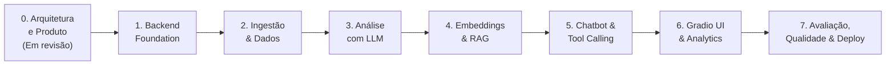

# Roadmap de Desenvolvimento — MesaIQ

**Versão:** 1.1  
**Status do Projeto:** Entrega 0 em revisão humana  
**Responsável pelo Projeto:** Desenvolvedor do Projeto (Estudante de Ciência da Computação)  

---

## 1. Visão Geral das Entregas

O desenvolvimento do **MesaIQ** é dividido em 8 etapas incrementais e testáveis (de 0 a 7). Cada entrega possui escopo estritamente delimitado, tarefas claras e critérios objetivos de conclusão (*Definition of Done*), garantindo avanço consistente e rastreável.

---

## 2. Detalhamento das Entregas

### Entrega 0: Product Definition & Architecture
- **Status:** **EM REVISÃO**
- **Objetivo:** Estabelecer a base técnica, visão de produto, requisitos funcionais/não funcionais, modelagem de dados revisada, diretrizes de governança e decisões arquiteturais (ADRs).
- **Tarefas Principais:**
  - [x] Elaborar o `README.md` com proposta de valor, visão geral e diagrama arquitetural.
  - [x] Consolidar o `AGENTS.md` com regras estritas de conduta técnica e limites arquiteturais.
  - [x] Escrever o `docs/PRD.md` com personas de unidade única, requisitos funcionais (RF-01 a RF-07) e critérios de aceitação.
  - [x] Escrever o `docs/ARCHITECTURE.md` com diagramas Mermaid, ERD revisado, consultas SQL válidas (sem subconsultas em índices parciais), contratos tipados de IA e verificação de citações no servidor.
  - [x] Elaborar os registros de decisões arquiteturais (`ADR-0001` a `ADR-0004`), documentando a data e o status do arquivamento do Chainlit no ADR-0002.
  - [x] Definir o `docs/ROADMAP.md` incremental com critérios de conclusão.
- **Critério de Conclusão:** Toda a documentação técnica inicial consistente, corrigida conforme a revisão de arquitetura e validada pelo desenvolvedor responsável.

---

### Entrega 1: Backend Foundation
- **Status:** Planejada (Próxima)
- **Objetivo:** Configurar o ecossistema do projeto com `uv`, FastAPI, validação com `pydantic-settings`, verificação de tipos com `mypy`, formatação/linting com `ruff`, SQLAlchemy 2 assíncrono e controle de versões de banco com Alembic.
- **Tarefas Principais:**
  - [ ] Inicializar o `pyproject.toml` e configurar o gerenciador de dependências `uv`.
  - [ ] Configurar tipagem estrita no `mypy` e linter/formatador no `ruff`.
  - [ ] Implementar `src/infrastructure/config.py` com validação de variáveis de ambiente via `pydantic-settings`.
  - [ ] Configurar conexão com PostgreSQL (`asyncpg` / SQLAlchemy 2) e habilitar extensão `vector`.
  - [ ] Criar a primeira migration no Alembic estabelecendo as tabelas principais (`restaurants`, `reviews`, `import_jobs`) com as chaves estrangeiras e índices B-tree correspondentes.
  - [ ] Criar endpoint básico de health check no FastAPI (`/api/v1/health`).
- **Critério de Conclusão:** Ambiente executando com migrations aplicadas com sucesso no PostgreSQL e testes unitários de configuração passando com `pytest` e checagem do `mypy` sem erros.

---

### Entrega 2: Review Management & Ingestion
- **Status:** Planejada
- **Objetivo:** Implementar o pipeline síncrono de ingestão de avaliações via arquivos CSV com validação, captura do `source_system`, deduplicação por `(restaurant_id, source_system, external_id)` e auditoria prévia de `ImportJob`.
- **Tarefas Principais:**
  - [ ] Implementar entidades de domínio e DTOs para `Review` (com `source_system`, `reviewed_at` e `imported_at`) e `ImportJob` (com `rows_imported`, `rows_skipped`, `rows_rejected`).
  - [ ] Criar o parser e validador de CSV em `src/infrastructure/parsers/`.
  - [ ] Implementar repositório `ReviewRepository` em SQLAlchemy com suporte a detecção de duplicatas (sem sobrescrever registros existentes no MVP).
  - [ ] Implementar caso de uso `ImportReviewsUseCase`, garantindo persistência do `ImportJob` com status `PROCESSING` antes da leitura dos dados e cálculo estrito: `rows_total = rows_imported + rows_skipped + rows_rejected`. Manter a importação desacoplada de criação de análises.
  - [ ] Criar rota de upload de CSV na API FastAPI para processamento de arquivos.
  - [ ] Escrever testes unitários e de integração para validação de formatos CSV válidos, corrompidos e duplicados.
- **Critério de Conclusão:** Capacidade de importar 500+ registros via CSV, gravando avaliações no banco com `source_system` e registrando dados estatísticos e de auditoria no `ImportJob`.

---

### Entrega 3: AI Analysis (LLM Structured Outputs)
- **Status:** Planejada
- **Objetivo:** Extrair sentimentos gerais, resumos e aspectos granulares das avaliações através do Google Gemini com Structured Outputs, suportando histórico de análises por configuração ativa, reserva individual atômica e recuperação de análises abandonadas.
- **Tarefas Principais:**
  - [ ] Criar migrations para as tabelas `review_analyses` e `review_aspects` com restrição única `(review_id, provider_name, model_name, prompt_version)`.
  - [ ] Implementar o contrato `LLMProvider` em `src/application/ports/` e o adaptador concreto `GeminiLLMAdapter` usando o Google Gen AI SDK.
  - [ ] Definir DTOs Pydantic tipados (`AnalysisResult`, `AspectResult`, `SentimentEnum`, `AspectCategoryEnum`) na camada Application, mantendo a camada Domain pura (dataclasses nativas).
  - [ ] Implementar rotina de recuperação de análises abandonadas (`PROCESSING` com `started_at < :stale_before` calculado via parâmetro `ANALYSIS_PROCESSING_TIMEOUT_SECONDS`) marcando-as como `FAILED`.
  - [ ] Implementar o caso de uso `ProcessPendingReviewsUseCase` com reserva individual atômica gerando `attempt_id` (UUID) (`FOR UPDATE OF r SKIP LOCKED LIMIT 1`), executando a chamada de rede ao LLM fora da transação de banco e persistindo o resultado via UPDATE condicional para esgrima de tentativas obsoletas.
  - [ ] Salvar metadados técnicos de auditoria (`provider_name`, `model_name`, `prompt_version`, `attempt_count`, `error_summary`, `started_at`, `finished_at`).
  - [ ] Implementar lógica de reprocessamento para análises em estado `FAILED` preservando as avaliações originais intactas.
  - [ ] Criar suíte de testes com mocks do provedor de LLM para testar tratamento de erros e respostas parciais.
- **Critério de Conclusão:** Avaliações com status `COMPLETED` respeitam 100% o schema estruturado para a configuração ativa, falhas de timeout são recuperadas como `FAILED` e locks de banco não são retidos durante chamadas externas de IA.

---

### Entrega 4: Embeddings & RAG
- **Status:** Planejada
- **Objetivo:** Gerar representações vetoriais locais fora da thread principal e configurar a busca semântica em base de dados vetorial sob modelo único ativo com controle de revisão.
- **Tarefas Principais:**
  - [ ] Criar migration para a tabela `review_embeddings` contendo coluna `vector(384)` e metadados de versão (`model_name`, `model_revision`).
  - [ ] Implementar contrato `EmbeddingProvider` e o adaptador local `E5LocalEmbeddingAdapter` com o modelo `intfloat/multilingual-e5-small`.
  - [ ] Configurar execução da inferência local em thread pool (`run_in_threadpool` / `asyncio.to_thread`) para não travar o loop assíncrono.
  - [ ] Garantir aplicação dos prefixos corretos: `passage:` para armazenamento e `query:` para busca.
  - [ ] Implementar caso de uso `RetrieveRelevantReviewsUseCase` executando busca vetorial exata no `pgvector` inicial.
  - [ ] Estabelecer governança de modelo único ativo: política de reindexação total caso haja substituição de modelo ou revisão (sem misturar vetores heterogêneos).
  - [ ] Realizar benchmark de latência e `Recall@5` para avaliar se há benefício na adoção do índice HNSW sobre o volume de dados.
- **Critério de Conclusão:** Busca semântica executada localmente sem chamadas a APIs pagas, recuperando as avaliações mais similares via `pgvector` com medição precisa de latência e recall.

---

### Entrega 5: AI Chatbot & Tool Calling
- **Status:** Planejada
- **Objetivo:** Desenvolver o assistente conversacional inteligente com catálogo restrito de ferramentas tipadas, validação referencial no servidor via `review_id` e garantia de fundamentação factual.
- **Tarefas Principais:**
  - [ ] Criar migrations para `chat_sessions` e `chat_messages`.
  - [ ] Implementar ferramentas tipadas com validação de parâmetros via esquemas Pydantic dedicados:
    - `get_review_metrics`: métricas calculadas em SQL determinístico (DTO estruturado `QuantitativeMetricDTO` sem SQL exposto).
    - `get_top_issues`: agregação de aspectos negativos por categoria (`GetTopIssuesArgs`).
    - `search_reviews`: busca semântica via RAG retornando lista de `ReviewEvidenceItem` com `review_id` canônico (`SearchReviewsArgs`).
    - `get_review_details`: busca detalhada com validação condicional estrita (somente `review_id` OU par `source_system` + `external_id`) via `GetReviewDetailsArgs`.
  - [ ] Implementar união discriminada para resposta da LLM (`ToolCallRequest` vs `FinalChatResponse`), prevenindo estados inválidos.
  - [ ] Implementar `CitationVerifierService` para validar que todos os `review_id` citados pelo LLM correspondem a avaliações efetivamente retornadas pelas ferramentas autorizadas.
  - [ ] Garantir a apresentação de dados e trechos originais do banco no frontend junto com `external_id` e `source_system`, sem permitir que o LLM substitua números exatos.
  - [ ] Implementar caso de uso `ProcessChatMessageUseCase` com loop de execução de ferramentas limitado (máximo 3 iterações) e injeção controlada do `restaurant_id`.
  - [ ] Escrever testes de integração simulando cenários adversariais de prompt injection e conferência de citações.
- **Critério de Conclusão:** Chatbot responde a perguntas operacionais invocando ferramentas corretas, sem executar SQL arbitrário, com referências canônicas (`review_id`) validadas no servidor e valores analíticos preservados.

---

### Entrega 6: Gradio Interface & Analytics
- **Status:** Planejada
- **Objetivo:** Unificar a experiência do usuário em uma interface web interativa com Gradio Blocks montada no FastAPI.
- **Tarefas Principais:**
  - [ ] Criar a estrutura da UI com Gradio Blocks:
    - Aba de Chatbot com histórico e citações verificadas.
    - Aba de Analytics com gráficos (distribuição de notas, evolução temporal, tópicos críticos).
    - Aba de Ingestão com upload de CSV e status do último `ImportJob`.
  - [ ] Conectar os componentes da UI exclusivamente aos casos de uso da camada de aplicação (sem acoplamento direto com banco ou provedores).
  - [ ] Montar a aplicação Gradio no FastAPI sob a rota `/app` via `gr.mount_gradio_app`.
  - [ ] Testar interatividade dos gráficos e upload de arquivos ponta a ponta.
- **Critério de Conclusão:** Interface web funcional rodando em `/app`, permitindo upload, visualização de métricas determinísticas e conversação fundamentada com o assistente.

---

### Entrega 7: Evaluation, Quality & Deployment
- **Status:** Planejada
- **Objetivo:** Avaliar formalmente a qualidade dos módulos de IA, consolidar suíte completa de testes, automação de CI e empacotar a aplicação para deploy.
- **Tarefas Principais:**
  - [ ] Criar benchmark de avaliação com dataset de teste rotulado manualmente (precisão, recall, macro-F1 de classificação e Recall@5 da recuperação semântica).
  - [ ] Medir e registrar métricas reais de latência e consumo de tokens sem estimativas artificiais.
  - [ ] Configurar `Dockerfile` multi-stage e `docker-compose.yml` (App FastAPI/Gradio + PostgreSQL/pgvector).
  - [ ] Configurar pipeline de CI no GitHub Actions (`ruff check`, `ruff format --check`, `mypy`, `pytest`).
  - [ ] Validar documentação final e manual de execução do projeto.
- **Critério de Conclusão:** Pipeline de CI no GitHub Actions executando com sucesso, relatório formal de avaliação de IA e aplicação funcional via Docker Compose.
